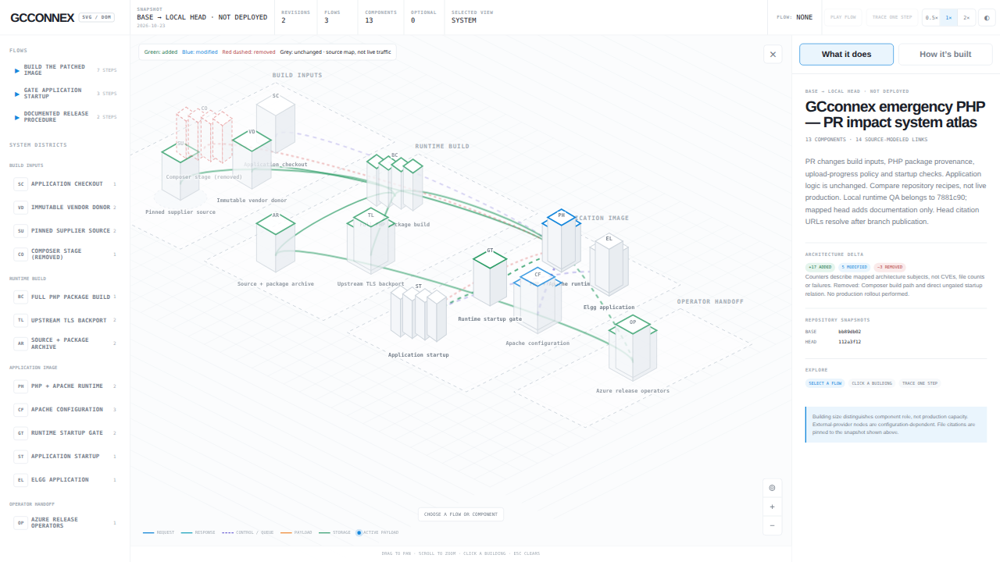

# GCconnex PHP emergency PR — review assets

These review-only files accompany the PHP emergency branch at commit `112a3f1260bafd1d28af754667c6cdacc2b72ecc`. They are deliberately separate from the application branch and are not part of the deployment image.

[Download the interactive map package](gcconnex-pr-impact.zip). Download/unzip the archive, then open `gcconnex-pr-impact.html` in a modern browser. No installation or network is needed for the map; source citations open GitHub only when clicked. GitHub itself displays HTML as source, not as a running application.

The source-cited comparison covers the repository base `bb89db027da3fac41d9248283cdb5f60812ae49c` and reviewed head above. It does not establish production state. Green = added; blue = modified; red dashed = removed; grey = unchanged context. Counts represent mapped architecture subjects, not vulnerabilities. The release procedure is documented, not executed.

The package README records validation, browser QA, and limits. Its original preparation status is historical; publication of these assets does not imply deployment or production verification.
